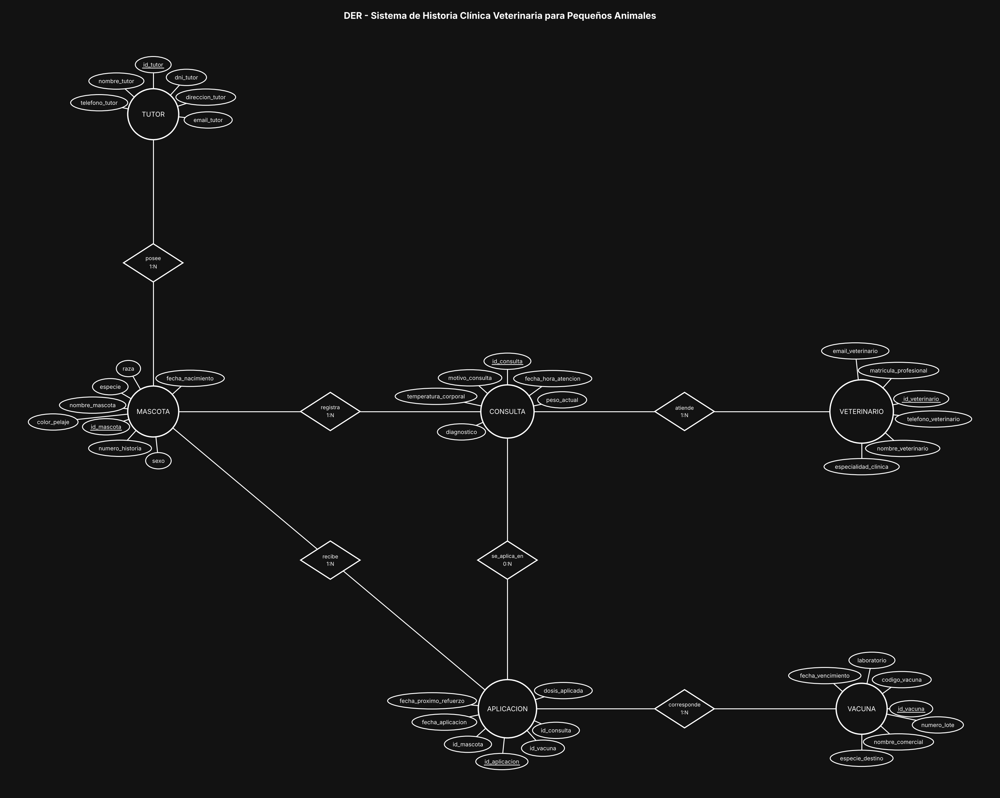

# BaseDeDatos-U2-Ej17-HistoriaClinicaVeterinaria

Base de Datos - Unidad 2 - Ejercicio 17

## Consigna

Modelar la historia clínica de una veterinaria de pequeños animales: tutores y sus mascotas, veterinarios con su especialidad, consultas con los datos del examen clínico, y aplicación de vacunas con control de refuerzos.

## Lógica

**TUTOR 1:N MASCOTA con participación obligatoria.** El enunciado dice que cada mascota pertenece obligatoriamente a un único tutor: la participación de MASCOTA en la relación es total, o sea que `id_tutor` no puede quedar en NULL. Un tutor sí puede tener varias mascotas.

**CONSULTA como entidad asociativa entre MASCOTA y VETERINARIO.** Ambas relaciones son 1:N hacia la consulta: una mascota tiene muchas consultas en su vida y un veterinario atiende muchas. No es un rombo simple porque tiene atributos propios y muchos.

**El peso y la temperatura van en la CONSULTA, no en la MASCOTA.** Este es el punto que conviene tener claro: son mediciones del momento de la atención, no propiedades del animal. Guardarlos en MASCOTA dejaría un único valor que se pisa en cada visita y se perdería la curva de peso, que es justamente lo que el veterinario mira para evaluar la evolución. En MASCOTA solo quedan los datos que no cambian (especie, raza, sexo, fecha de nacimiento, color).

**APLICACION como resolución del N:M entre MASCOTA y VACUNA.** Una mascota recibe muchas vacunas y una vacuna se aplica a muchas mascotas. `fecha_aplicacion` y `fecha_proximo_refuerzo` son atributos del acto de aplicar, no de la vacuna ni del animal: la misma vacuna tiene distinta fecha de refuerzo según cuándo se aplicó. Con esta estructura el sistema puede listar los refuerzos vencidos con una simple consulta por fecha.

**La aplicación se vincula opcionalmente a la consulta (0:N).** El enunciado aclara que las vacunas se aplican "en el transcurso de una consulta **o de manera preventiva**". Por eso el vínculo con CONSULTA es de participación opcional: `id_consulta` queda en NULL cuando la mascota va solo al vacunatorio. Si se forzara a que toda aplicación dependa de una consulta, habría que generar consultas ficticias para los planes sanitarios.

**El `numero_lote` va en VACUNA.** Siguiendo el enunciado, el lote identifica la partida del producto. Vale aclarar el matiz por si lo preguntan: en trazabilidad estricta el lote cambia entre partidas del mismo producto comercial, así que lo más riguroso sería llevarlo a la aplicación (qué lote puntual se le inoculó a ese animal) o crear una entidad LOTE dependiente de VACUNA.

**Trazabilidad de por vida (punto 4).** El historial se sostiene porque nada del pasado se sobrescribe: las consultas y las aplicaciones son entidades separadas con su propia fecha, y las mediciones quedan en cada registro. Para garantizarlo, los borrados deben ser restringidos, no en cascada: no debería poder eliminarse un tutor, un veterinario ni una vacuna que ya tengan registros clínicos asociados. Si el tutor cambia (venta o adopción), se actualiza la FK de la mascota y su historia clínica sigue intacta, porque cuelga de la mascota y no del dueño. Las bajas se manejan con un estado lógico (inactivo, fallecido) en lugar de borrar filas.

**Restricciones de integridad a considerar:** `fecha_proximo_refuerzo` posterior a `fecha_aplicacion`; la fecha de aplicación no puede ser anterior a la fecha de nacimiento de la mascota; si la aplicación se asocia a una consulta, esa consulta debe ser de la misma mascota; y la vacuna aplicada debería corresponder a la especie del paciente.

**Convención de claves.** Toda entidad lleva como PK un identificador propio `id_<entidad>` (subrayado en el diagrama) y al menos 5 atributos además del id; el código o documento de negocio (`dni`, `codigo_*`, `legajo`, etc.) queda como atributo común con restricción UNIQUE. Las entidades intermedias de las relaciones N:M llevan los tres ids: el propio y las dos FK de las entidades que unen (UNIQUE compuesto sobre ambas FK).

## Resultado

